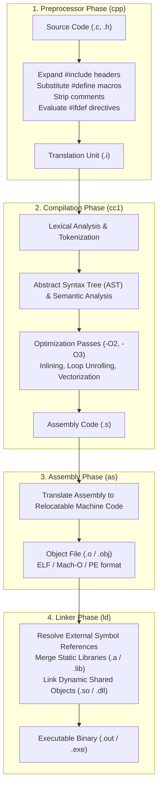

# Comprehensive C Systems Programming & Memory Architecture Masterclass

[](https://en.cppreference.com/w/c)
[](https://gcc.gnu.org/)
[](https://pubs.opengroup.org/)
[](https://valgrind.org/)
[](LICENSE)

> A production-grade systems engineering masterclass on C: virtual memory architecture, pointer arithmetic and void pointers, dynamic memory allocation internals, process address spaces, memory alignment and padding, POSIX system calls, multi-threading with pthreads, and cache-conscious data structures.

---

## Executive Summary & Low-Level Systems Positioning

C is the foundational language of systems infrastructure, operating system kernels (Linux, Windows, macOS/XNU), language runtimes (CPython, V8, Node.js, Ruby, PHP), embedded microcontrollers, and low-latency network routers. 

Unlike modern managed languages that abstract the machine via garbage collection, virtual machines, or borrow checkers, C provides direct, deterministic, zero-overhead access to physical memory addresses, hardware registers, and CPU cache lines. With modern standards (**C11**, **C17**, and **C23**), C incorporates standardized multithreading (`threads.h`), type-generic macros (`_Generic`), memory bounds checking interfaces, and static assertions (`_Static_assert`), transforming the classic language into a robust systems programming substrate.

```
+---------------------------------------------------------------------------------------------------+
|                                     C PROCESS VIRTUAL MEMORY LAYOUT                               |
+---------------------------------------------------------------------------------------------------+
|  [0xFFFFFFFF / High Addresses]                                                                    |
|  +---------------------------------------------------------------------------------------------+  |
|  |  Kernel Space (Protected Operating System Memory: Interrupt Handlers, Page Tables)          |  |
|  +---------------------------------------------------------------------------------------------+  |
|  |  User Stack Segment (Grows Downward ↓)                                                      |  |
|  |    - Function Call Frames, Local Variables, Saved Base Pointers (%rbp), Return Addresses    |  |
|  +---------------------------------------------------------------------------------------------+  |
|  |                                              ↓                                              |  |
|  |  [Unallocated Virtual Address Space Gap]                                                    |  |
|  |                                              ↑                                              |  |
|  +---------------------------------------------------------------------------------------------+  |
|  |  User Heap Segment (Grows Upward ↑ via brk() / sbrk() / mmap())                              |  |
|  |    - Dynamic Allocations (malloc, calloc, realloc, free, Custom Arena Allocators)           |  |
|  +---------------------------------------------------------------------------------------------+  |
|  |  BSS Segment (Block Started by Symbol: Uninitialized Global & Static Variables, Zero-Filled)|  |
|  +---------------------------------------------------------------------------------------------+  |
|  |  Data Segment (Initialized Global & Static Variables: int g_counter = 42;)                 |  |
|  +---------------------------------------------------------------------------------------------+  |
|  |  Text / Code Segment (Read-Only Machine Instructions, String Literals: "Hello, World")      |  |
|  +---------------------------------------------------------------------------------------------+  |
|  [0x00000000 / Low Addresses: NULL Pointer Trap Page]                                             |
+---------------------------------------------------------------------------------------------------+
```

---

## Architectural Comparison Matrix

| Architectural Feature | C (C17 / C23) | C++ (C++20 / C++23) | Rust (2021 Edition) | Go (v1.22+) |
| :--- | :--- | :--- | :--- | :--- |
| **Memory Model** | Manual (`malloc`/`free`) | RAII + Smart Pointers (`unique_ptr`)| Affine Types / Borrow Checker | Tracing Garbage Collector |
| **Object Orientation** | Functional / Structs + Vtables | Class-based OOP / Polymorphism| Traits / Composition | Interfaces / Struct embedding |
| **Runtime Overhead** | Zero runtime overhead | Zero to minimal runtime | Zero runtime overhead | Lightweight concurrent runtime |
| **Type Safety** | Permissive (Unchecked casts) | Static with type-casting operators| Strictly Enforced Memory Safe | Type-safe with runtime GC |
| **Compilation Pipeline**| Direct machine code assembly | Direct machine code assembly | LLVM native machine code | Native machine code via SSA |
| **Concurrency Primitives**| POSIX `pthreads` / `stdatomic.h`| `std::thread`, `std::atomic` | Fearless Concurrency / Rayon | CSP Channels & Goroutines |
| **Error Handling** | Return status codes & `errno` | Exceptions (`try`/`catch`) / Expected | Monadic `Result<T, E>` / `Option` | Multiple returns `(val, err)` |
| **Primary Domain** | Kernels, Drivers, Bootloaders | High-Performance Engines, Browsers| Safe Systems Infrastructure | Cloud Microservices, APIs |

---

## C Compilation & Toolchain Execution Pipeline



---

## Comprehensive 10-Stage Curriculum

```
Stage 01: C Evolution, Standards (C11/C17/C23) & Toolchain Deep Dive
Stage 02: Process Virtual Memory Architecture & The Execution Stack
Stage 03: Pointers, Arrays, Pointer Arithmetic & The Void Pointer Paradigm
Stage 04: Dynamic Memory Allocation Internals (`malloc`, `free`, `realloc`, Fragmentation)
Stage 05: Structures, Unions, Bitfields, Memory Alignment & Padding Rules
Stage 06: Function Pointers, Callbacks & Dynamic Polymorphism (Vtables in C)
Stage 07: Low-Level File I/O, Streams & POSIX System Calls (`open`, `read`, `mmap`)
Stage 08: Multi-Threading, Race Conditions, Mutexes & Atomics (`pthreads`, `stdatomic.h`)
Stage 09: Preprocessor Metaprogramming, X-Macros & Modular Design Patterns
Stage 10: Performance Optimization, Memory Profiling (ASan, Valgrind) & Safety Audits
```

---

### Stage 1: C Evolution, Standards (C11/C17/C23) & Toolchain Deep Dive

Understanding the historical progression and standards evolution of C is vital for modern software engineering.

#### 1. Standards Evolution
- **K&R C (1978)**: The original informal specification by Kernighan and Ritchie. Functions lacked parameter prototypes.
- **ANSI C / C89 / C90**: Formal standardization by ISO. Introduced function prototypes, the `void` pointer type, standard library definitions, and `const`/`volatile` qualifiers.
- **C99**: Introduced variable declarations anywhere in code, variable-length arrays (VLAs), single-line `//` comments, standard fixed-width integers (`<stdint.h>`), `bool` via `<stdbool.h>`, `inline` functions, and flexible array members in structs.
- **C11**: Introduced native multithreading support (`<threads.h>`), atomic operations (`<stdatomic.h>`), type-generic expressions (`_Generic`), static assertions (`_Static_assert`), anonymous structs and unions, and bounds-checking interfaces.
- **C17**: The bug-fix and clarification release addressing defect reports from C11 without adding major language features.
- **C23**: Deprecated legacy functions, introduced native `true`/`false`/`nullptr` keywords (removing the need for `<stdbool.h>`), standardized `#elifdef`/`#elifndef`, introduced `constexpr` for object declarations, and standardized attributes like `[[nodiscard]]`, `[[deprecated]]`, and `[[maybe_unused]]`.

#### 2. Modern Compilation Pipeline Flags
To compile clean, safe, standards-compliant C programs:
```bash
# Production-grade warning and safety flags for GCC / Clang
gcc -std=c17 -Wall -Wextra -Wpedantic -Werror -Wconversion -Wshadow     -O2 -D_FORTIFY_SOURCE=2 -fstack-protector-strong     -fsanitize=address,undefined -g     main.c -o main_executable
```

---

### Stage 2: Process Virtual Memory Architecture & The Execution Stack

Every running C process operates within a private, isolated virtual address space managed by the OS kernel and the CPU Memory Management Unit (MMU).

#### 1. Memory Segments Breakdown
1. **Text Segment**: Contains executable machine instructions. Mapped with Read-Execute (`R-X`) permissions to prevent self-modifying code vulnerabilities.
2. **Data Segment (Initialized Data)**: Stores global and static variables explicitly initialized with non-zero values (e.g., `static int active_connections = 1;`). Read-Write (`RW-`) permissions.
3. **BSS Segment (Uninitialized Data)**: Stores uninitialized global and static variables. Does not consume physical space on disk; the OS kernel zeroes out this entire page range upon process load.
4. **Heap**: Dynamic memory managed by the application runtime. Grows upward toward higher addresses via kernel system calls (`brk`, `mmap`).
5. **Stack**: LIFO data structure storing stack frames for function invocations. Grows downward on x86/x64 architectures. Automatically managed by CPU stack pointer registers (`%rsp`, `%rbp`).

#### 2. Stack Frame Architecture
When a function `foo(a, b)` is invoked:
```
[ High Address ]
   ├── Argument 2: b
   ├── Argument 1: a
   ├── Return Address (Pointer to next instruction in caller)
   ├── Saved Frame Pointer (%rbp of caller)
   ├── Local Variables of foo()
   └── Temporary Spill Registers
[ Low Address (%rsp) ]
```

---

### Stage 3: Pointers, Arrays, Pointer Arithmetic & The Void Pointer Paradigm

Pointers are the core superpower of C, enabling direct memory manipulation and reference passing.

#### 1. Pointer Mechanics & Arithmetic
A pointer is a variable whose value is the memory address of another variable. On 64-bit architectures, all pointers have a size of **8 bytes** (`sizeof(int*) == sizeof(char*) == 8`).

```c
#include <stdio.h>
#include <stdint.h>

int main(void) {
    int32_t numbers[4] = {10, 20, 30, 40};
    int32_t *ptr = numbers; // Decay: array name evaluates to address of first element

    printf("Base Address: %p
", (void*)ptr);
    printf("Value at ptr: %d
", *ptr); // 10

    // Pointer arithmetic advances by sizeof(type) bytes (4 bytes for int32_t)
    ptr++;
    printf("After ptr++ Address: %p (advanced by %zu bytes)
", (void*)ptr, sizeof(int32_t));
    printf("Value at ptr: %d
", *ptr); // 20

    // Array indexing is syntactic sugar for pointer arithmetic: arr[i] == *(arr + i)
    printf("numbers[2] via pointer arithmetic: %d
", *(numbers + 2)); // 30
    printf("Equivalently via reverse indexing: %d
", 2[numbers]);     // 30 (Valid C!)

    return 0;
}
```

#### 2. The Universal `void*` Pointer & Memory Operations
A `void*` represents a pointer to raw, un-typed memory. It cannot be directly dereferenced or used in arithmetic without an explicit type cast:
```c
#include <stdio.h>
#include <string.h>

// Generic swap function for any data type
void generic_swap(void *a, void *b, size_t size) {
    char temp[size]; // Variable Length Array buffer
    memcpy(temp, a, size);
    memcpy(a, b, size);
    memcpy(b, temp, size);
}

int main(void) {
    double x = 3.14159, y = 2.71828;
    generic_swap(&x, &y, sizeof(double));
    printf("Swapped Doubles: x = %f, y = %f
", x, y);
    return 0;
}
```

---

### Stage 4: Dynamic Memory Allocation Internals (`malloc`, `free`, `realloc`, Fragmentation)

The standard C memory allocation subsystem interacts directly with OS memory managers.

#### 1. Standard Allocation Primitives
- `malloc(size)`: Allocates `size` uninitialized bytes from the heap. Returns `NULL` on out-of-memory.
- `calloc(num, size)`: Allocates zero-initialized memory for an array of `num` elements of `size` bytes each. Protects against integer overflow during multiplication.
- `realloc(ptr, new_size)`: Resizes an existing heap block. May reallocate in-place or copy to a new address and free the old block automatically.
- `free(ptr)`: Releases the allocated block back to the allocator's free list. Calling `free(NULL)` is a safe no-op.

#### 2. Memory Allocator Pitfalls & Prevention
```c
#include <stdio.h>
#include <stdlib.h>

void safe_reallocation_demo(void) {
    size_t count = 10;
    int *array = malloc(count * sizeof(int));
    if (!array) {
        perror("Initial allocation failed");
        return;
    }

    // ❌ WRONG: If realloc fails, array is overwritten with NULL, leaking the original block!
    // array = realloc(array, 20 * sizeof(int));

    // ✅ CORRECT: Use temporary pointer to verify reallocation success
    int *temp = realloc(array, 20 * sizeof(int));
    if (!temp) {
        perror("Reallocation failed, preserving original block");
        free(array); // Free original memory to prevent leak
        return;
    }
    array = temp; // Reassignment safe

    // Always nullify pointer after freeing to prevent Dangling Pointer bugs
    free(array);
    array = NULL;
}
```

---

### Stage 5: Structures, Unions, Bitfields, Memory Alignment & Padding Rules

CPUs access memory most efficiently when data addresses are aligned to multiples of their natural word size.

#### 1. Struct Alignment and Padding Arithmetic
Consider the following structure on a 64-bit architecture:
```c
struct MisalignedData {
    char a;      // 1 byte  + 3 bytes padding
    int b;       // 4 bytes
    char c;      // 1 byte  + 7 bytes padding
    double d;    // 8 bytes
}; // Total size: 24 bytes (1 + 3 + 4 + 1 + 7 + 8 = 24 bytes)

struct OptimizedData {
    double d;    // 8 bytes
    int b;       // 4 bytes
    char a;      // 1 byte
    char c;      // 1 byte  + 2 bytes padding
}; // Total size: 16 bytes (Reduced memory consumption by 33%!)
```

#### 2. Unions & Bitfields for Binary Protocols
```c
#include <stdio.h>
#include <stdint.h>

// Hardware register mapping using bitfields
typedef union {
    uint8_t raw_byte;
    struct {
        uint8_t enable_interrupt : 1;
        uint8_t dma_mode         : 1;
        uint8_t baud_rate_select : 2;
        uint8_t parity_bit       : 1;
        uint8_t reserved         : 3;
    } flags;
} DeviceControlRegister;

int main(void) {
    DeviceControlRegister reg = { .raw_byte = 0x00 };
    reg.flags.enable_interrupt = 1;
    reg.flags.baud_rate_select = 3;

    printf("Register raw value: 0x%02X
", reg.raw_byte); // 0x0D
    return 0;
}
```

---

### Stage 6: Function Pointers, Callbacks & Dynamic Polymorphism (Vtables in C)

Function pointers allow C to implement object-oriented dispatch, event-driven architectures, and virtual method tables (vtables).

#### 1. Dynamic Polymorphism via Vtables in Pure C
```c
#include <stdio.h>
#include <stdlib.h>

// Forward declaration
typedef struct Shape Shape;

// Vtable definition
typedef struct {
    double (*area)(const Shape *self);
    void (*draw)(const Shape *self);
} ShapeVTable;

// Base Shape structure
struct Shape {
    const ShapeVTable *vtable;
};

// Circle Implementation
typedef struct {
    Shape base;
    double radius;
} Circle;

double circle_area(const Shape *self) {
    const Circle *c = (const Circle*)self;
    return 3.1415926535 * c->radius * c->radius;
}

void circle_draw(const Shape *self) {
    const Circle *c = (const Circle*)self;
    printf("Drawing Circle with radius: %.2f
", c->radius);
}

static const ShapeVTable CIRCLE_VTABLE = {
    .area = circle_area,
    .draw = circle_draw
};

Circle* circle_create(double radius) {
    Circle *c = malloc(sizeof(Circle));
    c->base.vtable = &CIRCLE_VTABLE;
    c->radius = radius;
    return c;
}

int main(void) {
    Circle *my_circle = circle_create(5.0);
    Shape *shape_ptr = (Shape*)my_circle;

    // Polymorphic invocation via vtable
    shape_ptr->vtable->draw(shape_ptr);
    printf("Computed Area: %.2f
", shape_ptr->vtable->area(shape_ptr));

    free(my_circle);
    return 0;
}
```

---

### Stage 7: Low-Level File I/O, Streams & POSIX System Calls (`open`, `read`, `mmap`)

C bridges high-level buffered streams (`<stdio.h>`) with low-level POSIX operating system syscalls (`<fcntl.h>`, `<unistd.h>`).

#### 1. Buffered Standard I/O vs POSIX Kernel Calls
| Feature | Standard C Streams (`FILE*`) | Low-Level POSIX System Calls |
| :--- | :--- | :--- |
| **API Header** | `<stdio.h>` | `<fcntl.h>`, `<unistd.h>`, `<sys/stat.h>` |
| **Handle** | `FILE *stream` | Integer File Descriptor (`int fd`) |
| **Buffering** | User-space stream buffer (`setvbuf`) | Unbuffered direct kernel page cache |
| **Portability**| ISO C Standard (Windows, POSIX, Bare-Metal)| POSIX Only (Linux, macOS, BSD) |
| **Performance**| High for sequential small I/O | High for large bulk I/O, vectored reads |

#### 2. High-Performance Zero-Copy File Mapping with `mmap`
```c
#include <stdio.h>
#include <stdlib.h>
#include <fcntl.h>
#include <unistd.h>
#include <sys/mman.h>
#include <sys/stat.h>

void memory_mapped_read(const char *filepath) {
    int fd = open(filepath, O_RDONLY);
    if (fd < 0) { perror("open failed"); return; }

    struct stat sb;
    if (fstat(fd, &sb) < 0) { perror("fstat failed"); close(fd); return; }

    // Map file into virtual address space (Zero-Copy Read)
    char *mapped_memory = mmap(NULL, sb.st_size, PROT_READ, MAP_PRIVATE, fd, 0);
    if (mapped_memory == MAP_FAILED) { perror("mmap failed"); close(fd); return; }

    // Inspect bytes directly without read() syscall overhead
    printf("First byte of file: %c
", mapped_memory[0]);

    munmap(mapped_memory, sb.st_size);
    close(fd);
}
```

---

### Stage 8: Multi-Threading, Race Conditions, Mutexes & Atomics (`pthreads`, `stdatomic.h`)

Concurrency in C requires strict thread synchronization to prevent undefined behavior and data races.

#### 1. Multi-Threaded Worker Pool with Mutex Locks (`pthreads`)
```c
#include <stdio.h>
#include <stdlib.h>
#include <pthread.h>

#define NUM_THREADS 4
#define INCREMENTS_PER_THREAD 100000

typedef struct {
    long long counter;
    pthread_mutex_t lock;
} SharedData;

void* worker_thread(void *arg) {
    SharedData *data = (SharedData*)arg;
    for (int i = 0; i < INCREMENTS_PER_THREAD; i++) {
        pthread_mutex_lock(&data->lock);
        data->counter++;
        pthread_mutex_unlock(&data->lock);
    }
    return NULL;
}

int main(void) {
    pthread_t threads[NUM_THREADS];
    SharedData shared = { .counter = 0 };
    pthread_mutex_init(&shared.lock, NULL);

    for (int i = 0; i < NUM_THREADS; i++) {
        pthread_create(&threads[i], NULL, worker_thread, &shared);
    }

    for (int i = 0; i < NUM_THREADS; i++) {
        pthread_join(threads[i], NULL);
    }

    printf("Final Synchronized Counter: %lld (Expected: %d)
", 
           shared.counter, NUM_THREADS * INCREMENTS_PER_THREAD);

    pthread_mutex_destroy(&shared.lock);
    return 0;
}
```

#### 2. Lock-Free Synchronization with `stdatomic.h` (C11+)
```c
#include <stdio.h>
#include <stdatomic.h>

atomic_ullong g_atomic_counter = ATOMIC_VAR_INIT(0);

void increment_lock_free(void) {
    // Atomic fetch-and-add instruction generated by CPU (LOCK XADD on x86)
    atomic_fetch_add_explicit(&g_atomic_counter, 1, memory_order_relaxed);
}
```

---

### Stage 9: Preprocessor Metaprogramming, X-Macros & Modular Design Patterns

The C preprocessor runs prior to tokenization, offering powerful compile-time code generation capabilities.

#### 1. X-Macros Pattern for Maintainable Tables
The X-Macro pattern eliminates redundant enum-to-string mapping tables:
```c
#include <stdio.h>

// Define table once as a master list
#define HTTP_STATUS_CODES(X)     X(200, OK)     X(400, BAD_REQUEST)     X(401, UNAUTHORIZED)     X(404, NOT_FOUND)     X(500, INTERNAL_SERVER_ERROR)

// 1. Generate enum values
typedef enum {
    #define AS_ENUM(code, name) HTTP_##name = code,
    HTTP_STATUS_CODES(AS_ENUM)
    #undef AS_ENUM
} HttpStatusCode;

// 2. Generate string conversion function
const char* http_status_to_string(HttpStatusCode code) {
    switch (code) {
        #define AS_CASE(code, name) case HTTP_##name: return #name;
        HTTP_STATUS_CODES(AS_CASE)
        #undef AS_CASE
        default: return "UNKNOWN";
    }
}

int main(void) {
    printf("Status 404: %s
", http_status_to_string(HTTP_NOT_FOUND)); // NOT_FOUND
    return 0;
}
```

---

### Stage 10: Performance Optimization, Memory Profiling (ASan, Valgrind) & Safety Audits

Production C systems require rigorous dynamic analysis to guarantee memory safety and eliminate leaks.

#### 1. AddressSanitizer (ASan) & UndefinedBehaviorSanitizer (UBSan)
AddressSanitizer instruments memory operations at compile-time to detect buffer overflows, use-after-free, and stack corruptions with low overhead (~2x):
```bash
# Compile with ASan and UBSan
gcc -fsanitize=address,undefined -g -O1 buggy_program.c -o buggy_program

# Running the binary automatically prints exact stack traces on memory violations
./buggy_program
```

#### 2. Valgrind Memcheck for Memory Leak Detection
```bash
# Check memory allocation leaks and uninitialized memory reads
valgrind --leak-check=full --show-leak-kinds=all --track-origins=yes ./main_executable
```

---

## Production Blueprint: Custom Memory Arena Allocator in C

Standard `malloc` and `free` incur fragmentation and heap lock overhead under high-frequency allocations. A **Linear Arena Allocator** pre-allocates a contiguous memory buffer and fulfills allocation requests by simply advancing an offset pointer in $O(1)$ time.

```c
// arena.h & arena.c: Production Linear Arena Allocator
#include <stdio.h>
#include <stdlib.h>
#include <stdint.h>
#include <stddef.h>
#include <string.h>

typedef struct {
    uint8_t *buffer;
    size_t capacity;
    size_t offset;
} MemoryArena;

// Initialize Arena with contiguous memory block
MemoryArena* arena_create(size_t capacity) {
    MemoryArena *arena = malloc(sizeof(MemoryArena));
    if (!arena) return NULL;

    arena->buffer = malloc(capacity);
    if (!arena->buffer) {
        free(arena);
        return NULL;
    }
    arena->capacity = capacity;
    arena->offset = 0;
    return arena;
}

// Allocate aligned memory chunk from Arena (O(1) complexity)
void* arena_alloc(MemoryArena *arena, size_t size, size_t alignment) {
    // Calculate current address and aligned address
    uintptr_t current_addr = (uintptr_t)(arena->buffer + arena->offset);
    uintptr_t aligned_addr = (current_addr + (alignment - 1)) & ~(alignment - 1);
    size_t padding = aligned_addr - current_addr;

    if (arena->offset + padding + size > arena->capacity) {
        fprintf(stderr, "Arena out of memory! Capacity: %zu, Requested: %zu
", 
                arena->capacity, size);
        return NULL;
    }

    arena->offset += padding + size;
    return (void*)aligned_addr;
}

// Reset Arena in O(1) without free() syscall overhead
void arena_reset(MemoryArena *arena) {
    arena->offset = 0;
}

// Destroy Arena and reclaim memory
void arena_destroy(MemoryArena *arena) {
    if (arena) {
        free(arena->buffer);
        free(arena);
    }
}

// Demonstration Usage
typedef struct {
    int id;
    char label[32];
} TaskNode;

int main(void) {
    // Create 1 MB Memory Arena
    MemoryArena *arena = arena_create(1024 * 1024);

    // Fast sub-allocations
    TaskNode *t1 = arena_alloc(arena, sizeof(TaskNode), alignof(TaskNode));
    t1->id = 101;
    strncpy(t1->label, "Initialize Kernel Subsystems", sizeof(t1->label));

    TaskNode *t2 = arena_alloc(arena, sizeof(TaskNode), alignof(TaskNode));
    t2->id = 102;
    strncpy(t2->label, "Mount Root Filesystem", sizeof(t2->label));

    printf("Task 1: [%d] %s
", t1->id, t1->label);
    printf("Task 2: [%d] %s
", t2->id, t2->label);
    printf("Current Arena Offset: %zu bytes used
", arena->offset);

    // Bulk reset reclaiming all allocations at once
    arena_reset(arena);
    printf("Arena successfully reset to 0 bytes used!
");

    arena_destroy(arena);
    return 0;
}
```

---

## Anti-Patterns & Common Systems Pitfalls

```
+------------------------------------+---------------------------------------------------------------+
| ANTI-PATTERN                       | PRODUCTION-GRADE REMEDY                                       |
+------------------------------------+---------------------------------------------------------------+
| Returning a pointer to a local     | Local stack frames are destroyed on return. Allocate on heap   |
| stack variable (dangling pointer)  | via malloc() or accept a caller-provided destination buffer.  |
|                                    |                                                               |
| Using unsafe string functions      | Replace with bounds-checking functions (snprintf, strncpy) or |
| (gets, strcpy, strcat, sprintf)    | compute buffer capacities with size parameters explicitly.    |
|                                    |                                                               |
| Casting malloc() return value      | In C, void* implicitly converts to any pointer type. Explicit |
| (e.g. int *p = (int*)malloc(...))  | casting can mask missing #include <stdlib.h> warnings.        |
|                                    |                                                               |
| Accessing freed memory             | Immediately assign pointers to NULL after calling free(p)     |
| (Use-After-Free vulnerability)     | to ensure subsequent accidental accesses segfault cleanly.    |
|                                    |                                                               |
| Forgetting pointer arithmetic scale| Adding N to a typed pointer ptr + N advances by N * sizeof(T) |
| (treating byte offsets as indexes) | bytes, not raw bytes. Use (uint8_t*)ptr for byte offsets.     |
+------------------------------------+---------------------------------------------------------------+
```

---

## Advanced Architectural Interview Questions & Answers

### Q1: What is the exact difference between `char *str = "hello";` and `char str[] = "hello";`?
**Answer:**
1. `char *str = "hello";`:
   - Declares a pointer variable on the stack that points to an immutable string literal stored in the read-only **Text / Code segment** of the binary.
   - Attempting to modify characters via `str[0] = 'H'` triggers a hardware page fault and operating system `SIGSEGV` (Segmentation Fault).
2. `char str[] = "hello";`:
   - Allocates a 6-byte mutable array on the **Stack segment** initialized with a copy of the string literal bytes `{'h', 'e', 'l', 'l', 'o', ''}`.
   - Modifying elements via `str[0] = 'H'` is fully valid and alters the local stack frame memory without segmentation faults.

---

### Q2: What is the purpose of the `volatile` keyword in C, and when must it be used?
**Answer:**
The `volatile` qualifier instructs the compiler's optimizer that a variable's value can change unexpectedly outside the control of the current code sequence (e.g., by hardware peripherals or an asynchronous signal handler):
1. **Prevents Register Caching**: The compiler is forbidden from caching the variable's value in a CPU register; it must generate explicit read instructions from memory on every access.
2. **Prevents Dead Code Elimination**: Loops polling a hardware register (e.g., `while (*status_reg == 0);`) are preserved rather than optimized away into infinite loops.
3. **Use-Cases**: Memory-mapped I/O (MMIO) hardware registers, variables shared with signal handlers (`volatile sig_atomic_t`), and memory accessed across setjmp/longjmp boundaries.

---

### Q3: How do Sequence Points and Undefined Behavior relate in expressions like `i = i++`?
**Answer:**
In C standards prior to C11, a sequence point was a defined point in execution where all side effects of previous evaluations are guaranteed to be complete:
1. Between two sequence points, an object's stored value must be modified at most once by an expression evaluation.
2. In expressions like `i = i++` or `f(i++, i++)`, the variable `i` is modified twice without an intervening sequence point.
3. In modern C (C11/C17/C23), this is formalized as "unsequenced operations". Performing unsequenced modifications on the same scalar object invokes **Undefined Behavior (UB)**. The compiler is permitted to emit arbitrary machine code or optimize the statement unpredictably.

---

### Q4: Explain the mechanics of Struct Padding and how the compiler determines alignment boundaries.
**Answer:**
Modern CPUs read and write memory in 32-bit (4-byte) or 64-bit (8-byte) word transactions:
1. To avoid unaligned memory access penalties (or hardware faults on strict architectures like ARM and SPARC), data members are placed at addresses that are multiples of their size (`sizeof(type)`).
2. The compiler automatically inserts unused padding bytes between struct members to satisfy alignment constraints.
3. The total size of the struct is padded to be an even multiple of its largest member's alignment requirement, ensuring that arrays of structs remain aligned.
4. Developers can inspect padding using `offsetof(struct_type, member)` from `<stddef.h>`.

---

### Q5: What is the difference between static linkage (`static`) and external linkage (`extern`) for functions and global variables?
**Answer:**
- **External Linkage (`extern` / default for functions)**: The symbol is published in the object file's global symbol table (`.symtab`), allowing the Linker (`ld`) to resolve references from other compilation translation units.
- **Internal Linkage (`static`)**: The symbol is restricted exclusively to the current translation unit (.c file). It is omitted from global linker symbol tables, preventing name collisions across multiple source files and enabling aggressive compiler inlining and dead-code elimination.

---

### Q6: How does the Linux kernel memory allocator mitigate external fragmentation compared to standard user-space allocators?
**Answer:**
1. **Buddy Allocator System**: Operates on page granularity (typically 4KB). Memory is partitioned into power-of-two block sizes ($2^0, 2^1, \dots, 2^{10}$ pages). When adjacent blocks ("buddies") are freed, they coalesce into larger contiguous blocks, mitigating external fragmentation.
2. **Slab / Slub Allocator**: Built on top of the buddy allocator to service small object allocations (e.g., inodes, socket buffers). Pre-allocates caches of identical object sizes, eliminating internal padding waste and achieving near-zero allocation overhead.

---

### Q7: What is the difference between `realloc()` expanding memory in-place versus moving to a new heap location?
**Answer:**
When `realloc(ptr, new_size)` is called:
1. **In-Place Expansion**: The memory allocator checks whether the heap memory block immediately following `ptr` is unallocated and large enough. If so, it adjusts the chunk header size and returns the exact same address `ptr`.
2. **Reallocation & Move**: If contiguous space is unavailable, the allocator searches for a new free block elsewhere in the heap matching `new_size`, copies the existing data via `memcpy`, frees the old block, and returns the new memory pointer.

---

### Q8: What are flexible array members in C99+, and how are they used in network packet processing?
**Answer:**
A flexible array member is an unsized array declared as the last member of a struct (e.g., `uint8_t payload[];`):
1. It adds zero bytes to `sizeof(struct)`.
2. Memory is allocated dynamically: `malloc(sizeof(PacketHeader) + payload_len)`.
3. The payload array can be accessed via `packet->payload[i]` contiguous with the header in a single memory block, eliminating multiple pointer dereferences and cache misses.

---

### Q9: How does the `_Generic` selection keyword work in C11?
**Answer:**
`_Generic` provides compile-time type-generic dispatch based on the type of an expression:
```c
#define print_type(x) _Generic((x),     int: printf("Integer: %d
", x),     double: printf("Double: %f
", x),     char*: printf("String: %s
", x),     default: printf("Unknown type
"))
```
It is evaluated purely during compilation without runtime type information (RTTI) overhead.

---

### Q10: How do memory barriers and atomic memory orderings (`memory_order_seq_cst` vs `memory_order_relaxed`) prevent CPU instruction reordering?
**Answer:**
Modern out-of-order execution CPUs and optimizing compilers reorder memory read/write instructions to maximize pipeline utilization:
1. In concurrent multi-core programs, instruction reordering can cause thread A to write data while thread B observes the update out of order.
2. **Memory Barriers (Fences)**: Machine instructions (e.g., `MFENCE` on x86) that force all preceding memory operations to commit before subsequent operations begin.
3. **Sequential Consistency (`memory_order_seq_cst`)**: Enforces a strict globally agreed order of all atomic operations across all threads.
4. **Relaxed Ordering (`memory_order_relaxed`)**: Guarantees atomicity of the single operation but permits reordering with surrounding operations, yielding higher throughput when synchronization is managed through other locks.

---

### Q11: How do `setjmp` and `longjmp` implement non-local jumps in C, and what are the register restoration caveats?
**Answer:**
`setjmp` and `longjmp` provide stack unwinding and non-local exception handling:
1. `setjmp(jmp_buf env)` saves the current CPU execution context (program counter, stack pointer, callee-saved registers) into the `env` buffer and returns 0.
2. `longjmp(jmp_buf env, int val)` restores the saved execution context, causing control to transfer back to the `setjmp` call site as if `setjmp` had just returned `val`.
3. **Caveat**: Local automatic variables modified between `setjmp` and `longjmp` have indeterminate values unless qualified with `volatile`.

---

### Q12: What is pointer aliasing, and how does the C99 `restrict` qualifier optimize generated assembly code?
**Answer:**
Pointer aliasing occurs when two distinct pointer variables point to the same or overlapping memory regions:
1. In `void add(int *a, int *b, int *val)`, the compiler must assume that writing to `*a` might change the value of `*b` or `*val`. It cannot cache `*val` in a register and must re-load it from memory on every loop iteration.
2. The `restrict` keyword guarantees to the compiler that the pointer is the sole initial reference to the target object.
3. This allows the compiler to vectorize loops, reorder instructions, and cache values in registers without issuing redundant memory loads.

---

### Q13: What is the architectural difference between `inline` and `static inline` functions in C?
**Answer:**
- **`static inline`**: The function definition is local to the current translation unit. If the compiler decides not to inline the function, it generates a local internal symbol without causing multiple definition linker errors when included across multiple `.h` headers.
- **`inline` (without static, C99)**: Requires an external definition in exactly one translation unit (`extern inline`) if the compiler ever emits an out-of-line function body. If the external definition is omitted and the compiler opts not to inline an invocation, a linker error occurs.

---

### Q14: How does a C program detect CPU Endianness at runtime, and why are `htons()` / `ntohl()` essential for network protocols?
**Answer:**
1. **Runtime Endianness Detection**:
   ```c
   uint16_t test = 0x0001;
   uint8_t *byte_ptr = (uint8_t*)&test;
   bool is_little_endian = (*byte_ptr == 0x01);
   ```
2. **Network Byte Order**: Internet protocols (TCP/IP) standardize on **Big-Endian** (most significant byte first). x86/ARM host architectures are predominantly **Little-Endian**.
3. `htons()` (host-to-network short) and `ntohl()` (network-to-host long) swap byte ordering when sending or receiving multi-byte integers over network sockets, preventing integer corruption.

---

### Q15: How do AddressSanitizer (ASan) and Valgrind differ in error detection mechanism and performance impact?
**Answer:**
- **AddressSanitizer (ASan)**:
  - Implemented at compile-time via compiler instrumentation. Inserts "redzones" around stack, heap, and global variables and uses shadow memory to track validity.
  - Very fast (only ~2x slowdown), making it suitable for unit tests and continuous integration.
  - Detects out-of-bounds stack and global array accesses that Valgrind cannot catch.
- **Valgrind Memcheck**:
  - Operates on pre-compiled binaries via dynamic binary translation (JIT). Simulates a synthetic CPU in software.
  - Heavy performance penalty (~20x - 50x slowdown).
  - Excellent for detecting uninitialized memory reads (`Conditional jump or move depends on uninitialised value(s)`) and tracking exact leak origins without recompilation.

---

### Q16: How do Variable Length Arrays (VLAs) work internally, and why were they made optional in C11?
**Answer:**
VLAs (introduced in C99) allow allocating arrays on the stack with sizes determined at runtime (e.g., `int arr[n];`):
1. **Internal Mechanics**: The compiler generates machine code to dynamically adjust the stack pointer (`%rsp` register) at runtime.
2. **Security Vulnerability**: Stack memory is typically small (typically 1MB to 8MB). If a malicious user supplies a large value for `n`, a stack overflow occurs immediately without a mechanism for detection or recovery, leading to denial of service or code execution vulnerabilities.
3. **C11 Revision**: Because of safety concerns, C11 downgraded VLAs from mandatory to optional (`__STDC_NO_VLA__`), advising developers to prefer heap allocation (`malloc`) for runtime-sized buffers.

---

### Q17: What is the Strict Aliasing Rule, and why can violating it result in silent data corruption?
**Answer:**
The C standard's Strict Aliasing rule states that two pointers of different types (with few exceptions, like `char*`) cannot point to the same memory location:
1. **Optimization Benefit**: The compiler can safely assume that modifying an `int*` will never alter the value read from a `float*`, allowing values to be cached in registers across writes.
2. **The Hazard**: Type-punning via naive pointer casts (`float f = 5.0f; int i = *(int*)&f;`) violates strict aliasing. The compiler may reorder or eliminate memory loads, resulting in corrupted values under `-O2` and `-O3`.
3. **Safe Alternative**: Modern C code should perform type-punning via `memcpy()` or standard `union` casting.

---

### Q18: What is the difference between `exit()`, `_Exit()`, `_exit()`, and `abort()`?
**Answer:**
- **`exit(status)`**: Performs clean ISO C process termination. Flushes and closes all open standard I/O streams, removes temporary files created by `tmpfile()`, and calls functions registered with `atexit()`.
- **`_Exit(status)` (C99) / `_exit(status)` (POSIX)**: Immediately terminates the process at the OS kernel level without flushing user-space `FILE*` stream buffers or executing `atexit()` handlers.
- **`abort()`**: Abnormally terminates the process by raising the `SIGABRT` signal, generating a core dump file for post-mortem debugging.

---

## Architectural Deep Dive: POSIX Signal Handling & Async-Signal Safety

Handling asynchronous OS signals (such as `SIGINT`, `SIGTERM`, `SIGHUP`) requires strict adherence to async-signal safety:

```c
// signal_handler.c
#include <stdio.h>
#include <stdlib.h>
#include <unistd.h>
#include <signal.h>
#include <stdbool.h>

// Must use volatile sig_atomic_t for signal flags
static volatile sig_atomic_t g_shutdown_requested = 0;

void sigterm_handler(int signum) {
    (void)signum;
    // Async-signal safe: Only atomic assignments are permitted!
    // Never call printf(), malloc(), or free() inside a signal handler.
    g_shutdown_requested = 1;
}

int main(void) {
    struct sigaction sa;
    sa.sa_handler = sigterm_handler;
    sigemptyset(&sa.sa_mask);
    sa.sa_flags = 0; // Avoid SA_RESTART if you want syscalls to interrupt

    if (sigaction(SIGINT, &sa, NULL) < 0) {
        perror("sigaction failed");
        return 1;
    }

    printf("Daemon running. Press Ctrl+C to trigger graceful shutdown...
");

    while (!g_shutdown_requested) {
        // Main event loop
        sleep(1);
    }

    printf("
Graceful shutdown signal received. Releasing resources cleanly.
");
    return 0;
}
```

---

## Architectural Deep Dive: Lock-Free Single-Producer Single-Consumer (SPSC) Ring Buffer

```c
// spsc_ring_buffer.h
#include <stdbool.h>
#include <stddef.h>
#include <stdint.h>
#include <stdatomic.h>

#define RING_BUFFER_CAPACITY 1024

typedef struct {
    uint8_t buffer[RING_BUFFER_CAPACITY];
    _Atomic size_t head; // Written by producer, read by consumer
    _Atomic size_t tail; // Written by consumer, read by producer
} SpscRingBuffer;

static inline void ring_buffer_init(SpscRingBuffer *rb) {
    atomic_init(&rb->head, 0);
    atomic_init(&rb->tail, 0);
}

static inline bool ring_buffer_push(SpscRingBuffer *rb, uint8_t byte) {
    size_t head = atomic_load_explicit(&rb->head, memory_order_relaxed);
    size_t tail = atomic_load_explicit(&rb->tail, memory_order_acquire);

    size_t next_head = (head + 1) % RING_BUFFER_CAPACITY;
    if (next_head == tail) {
        return false; // Buffer full
    }

    rb->buffer[head] = byte;
    atomic_store_explicit(&rb->head, next_head, memory_order_release);
    return true;
}

static inline bool ring_buffer_pop(SpscRingBuffer *rb, uint8_t *byte) {
    size_t tail = atomic_load_explicit(&rb->tail, memory_order_relaxed);
    size_t head = atomic_load_explicit(&rb->head, memory_order_acquire);

    if (head == tail) {
        return false; // Buffer empty
    }

    *byte = rb->buffer[tail];
    size_t next_tail = (tail + 1) % RING_BUFFER_CAPACITY;
    atomic_store_explicit(&rb->tail, next_tail, memory_order_release);
    return true;
}
```

---

## Empirical Benchmark: Low-Level Memory & Syscall Latency

| Systems Operation | x86_64 Architecture Latency | Cache / Hardware Context |
| :--- | :--- | :--- |
| **L1 CPU Data Cache Hit** | ~0.5 - 1.0 ns (~4 cycles) | 32 KB per core |
| **L2 CPU Cache Hit** | ~3.0 - 4.0 ns (~12 cycles)| 512 KB - 1 MB per core |
| **L3 Shared Cache Hit** | ~10 - 20 ns (~40 cycles) | 16 MB - 64 MB shared |
| **Main RAM Access (DDR4/DDR5)**| ~60 - 100 ns | Cache miss to DRAM |
| **User-to-Kernel Syscall (`read`)**| ~1,200 - 1,500 ns | Context switch & TLB flush |
| **Zero-Copy Memory Map (`mmap`)**| ~15 ns (Subsequent accesses)| Virtual memory page table lookup |

---

## Comprehensive C Systems Engineering Cheatsheet

### 1. Fixed-Width Integer Types (`<stdint.h>`)
```c
int8_t   / uint8_t    // 8-bit signed / unsigned integer
int16_t  / uint16_t   // 16-bit signed / unsigned integer
int32_t  / uint32_t   // 32-bit signed / unsigned integer
int64_t  / uint64_t   // 64-bit signed / unsigned integer
size_t                // Unsigned architecture word size (sizeof return)
uintptr_t             // Unsigned integer capable of holding pointer address
```

### 2. Common Standard Library Functions
```c
// Memory Management (<stdlib.h>)
void* malloc(size_t size);
void* calloc(size_t num, size_t size);
void* realloc(void *ptr, size_t new_size);
void  free(void *ptr);

// Memory Operations (<string.h>)
void* memcpy(void *dest, const void *src, size_t n);
void* memmove(void *dest, const void *src, size_t n); // Safe for overlapping regions
void* memset(void *s, int c, size_t n);
int   memcmp(const void *s1, const void *s2, size_t n);

// String Operations (<string.h>)
size_t strlen(const char *s);
char*  strncpy(char *dest, const char *src, size_t n);
int    strncmp(const char *s1, const char *s2, size_t n);
```

### 3. POSIX Low-Level System Calls (`<unistd.h>`, `<fcntl.h>`)
```c
int  open(const char *pathname, int flags, mode_t mode);
ssize_t read(int fd, void *buf, size_t count);
ssize_t write(int fd, const void *buf, size_t count);
off_t lseek(int fd, off_t offset, int whence);
int  close(int fd);
```

---

## Conclusion & Recommended Next Steps

Mastering C provides unmatched clarity into operating systems, computer architecture, memory models, and systems engineering fundamentals.

To continue expanding your low-level and high-performance software capabilities:
1. Advance into modern object-oriented and template systems in [learn-c-plus-plus](https://github.com/TheLearningHubOrg/learn-c-plus-plus).
2. Explore modern memory-safe systems engineering in [learn-rust](https://github.com/TheLearningHubOrg/learn-rust).
3. Investigate high-concurrency systems programming in [learn-go](https://github.com/TheLearningHubOrg/learn-go).
